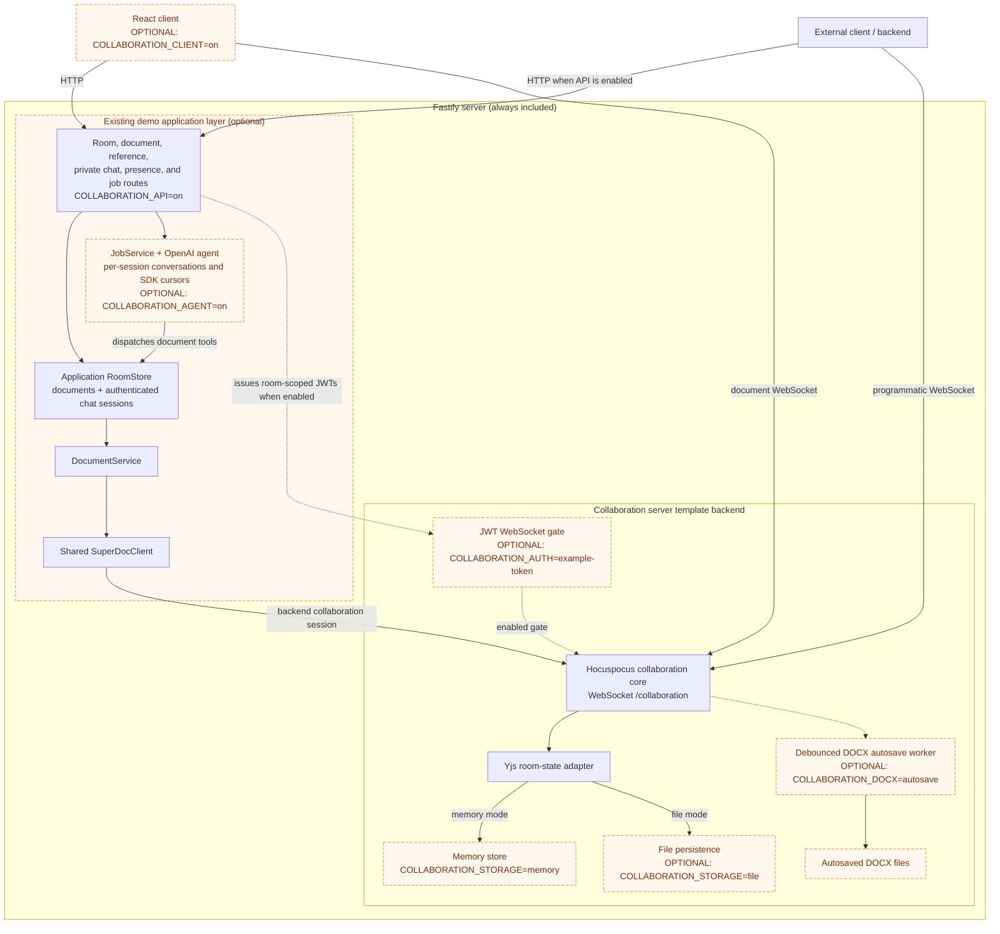

# SuperDoc canonical collaboration demo

A reference application for collaborative editing in SuperDoc. Each browser session can work with its own named agent on the shared document. Everything runs locally, and model requests go directly to OpenAI with your API key.

## Private chats and agent cursors

The demo follows the published stable releases: `@superdoc/sdk` 2.31.0, `superdoc` 2.34.0, and `@superdoc/react` 2.29.0. The shared updater advances all three packages from npm's `latest` tags. Run the normal `make dev` command; no Orbit checkout or local package build is required.

Open the same room URL in two browser sessions. Each session gets a private chat and a randomly assigned plant or tree name, such as Willow, Lavender, or Chrysanthemum. Names are unique within the room and stay with the session when you reload in the same tab. The top bar stacks the browser user count above the agent count. Each open chat or running request counts once, and a closed chat drops out when its last request finishes.

With `COLLABORATION_AGENT=on` and `COLLABORATION_AGENT_PRESENCE=on`, the server opens a dedicated SuperDoc SDK handle when an agent first works on the document. The handle joins the shared Hocuspocus room and publishes the agent’s name on a purple cursor. Native presence follows edits, including incremental streamed text. Closing the chat releases its handle once its work finishes. The room’s primary SDK handle owns the shared document lifecycle. Turning off cursor presence leaves private chat and its connection count available.

`npm run test:browser --prefix client` tests the built frontend and real demo backend in Chromium with a local OpenAI-compatible stub. The suite covers separate chats, named cursors and connection counts during collaborative edits, selection and caret prompts, image and file attachments, and microphone dictation. Run `make install` first. The tests use ports 18000 and 18173 and need no model key. Run `npm run test:browser --prefix client -- agent-composer.spec.ts` to run only the composer scenarios.

To preview the agent panel without a model key, run `COLLABORATION_AGENT=off VITE_COLLABORATION_AGENT=on make dev`. You can compose a prompt; Send remains disabled with a configuration message until the backend agent is enabled.

## Architecture



Orange dashed blocks are optional. The Fastify host and Hocuspocus collaboration core are always present. The bundled React client, HTTP application layer, agent worker, JWT gate, file-backed Yjs persistence, and DOCX autosave can be included or excluded with the flags shown. The room-state adapter is always present, using either memory or file storage; the two storage blocks are alternatives rather than simultaneous destinations.

The browser owns the UI and interactive editor. When enabled, the HTTP application layer owns room metadata, uploads/downloads, references, chat, expiry, token issuance, and jobs. Each application room owns one document object, while `DocumentService` owns the shared SDK client. Browser and backend SDK sessions edit through the same Hocuspocus document. Each room keeps its conversations and agent identities by browser session. A browser generates a random session credential and keeps it in session storage. The HTTP agent endpoints use that credential to scope conversations, job access, and presence, independently of the WebSocket token used to join the document. The collaboration layer, adapted from the SuperDoc collaboration server template, owns WebSocket authorization, Yjs room-state storage, and optional debounced DOCX snapshots; it can also run without the bundled client and HTTP application layer.

### Document Upload/Room Creation

When the client creates a blank document or uploads a DOCX, the server performs this sequence:

1. `RoomStore` writes the blank or uploaded DOCX to the ephemeral document directory.
2. `RoomStore` asks `DocumentService` to open the file.
3. `DocumentService` uses its shared `SuperDocClient` to open an SDK document handle.
4. The SDK handle connects to Hocuspocus using the room ID as the document ID and seeds the collaboration state from the DOCX.
5. `DocumentService` creates a `Document` containing the SDK handle, document ID, filename, file path, and generation number.
6. `RoomStore` creates a `Room` that owns the `Document`.
7. The API returns the document metadata and collaboration URL.
8. The browser initializes SuperDoc with that metadata and connects to the same Hocuspocus document.
9. Hocuspocus synchronizes the seeded document state into the browser editor.

After initialization, live document edits travel through Hocuspocus. The source DOCX is not rewritten after every edit. When the document is downloaded, `Document.save()` exports the current SDK state to a temporary DOCX file.

### Prompt Submission/Job Creation

Submitting a prompt creates an asynchronous agent job. The agent applies document edits during its tool-call loop rather than waiting until the job is complete:

1. The client sends the prompt and Reviewing or Editing mode with its session credential.
2. `JobService` validates the room and queues a job under that session. The API replies with `202 Accepted` and the job ID.
3. The worker runs the model with only that session’s conversation. When native cursor presence is enabled, it uses the session’s named SDK handle for document operations through the shared reference adapter.
4. Document edits travel through Hocuspocus to all collaborators. The worker serializes jobs so their writes go through the existing document safeguards.
5. Job status and reply text stream to the requesting session. The client polls job status if the stream drops.
6. The completed prompt, reply, and attachment preview are saved in that session’s conversation.


## Quick start

Prerequisites:

- Node.js 22 or newer
- `make`
- An OpenAI API key

From this directory:

```bash
cp .env.example .env
```

Add your key to `.env`:

```dotenv
OPENAI_API_KEY=your-key-here
```

The checked-in example profile enables the API, client, and agent while using unauthenticated,
in-memory collaboration with DOCX autosave disabled. These are the same quick-start flags shown
by **Build this** in the client.

The gallery's **Build this** button and the client's modal both use
`client/src/build-app.sh`. Change that file to update both commands. CI compares
the gallery's rendered command with the client's imported command, then runs the
complete snippet in an isolated checkout with `SUPERDOC_BUILD_ONLY=1`. That flag
exits after `make build`, before requesting an API key or starting servers. The
test clone uses the PR's source (including dependency-update artifacts), and
`make build` installs from the checked-in lockfiles with `npm ci`.

Run the same check locally from the repository root:

```bash
node scripts/verify-build-this.mjs --demo agentic-collaboration --run
```

Start the complete stack:

```bash
make dev
```

All service logs are shown by default. Filter them with either launcher form:

```bash
node scripts/dev.mjs --log documentservice
make dev LOG=documentservice
```

`--log` accepts `all`, `api`, `rooms`, `worker`, `agent`, `documentservice`, `collab`, `client`, or `dev`. Use commas for multiple selections, such as `--log api,collab`. The `worker` selection refers to agent-job lifecycle logs; `documentservice` refers to SDK document operations.

The first run installs the Node dependencies. Open [http://localhost:15173](http://localhost:15173). Press Ctrl-C once to stop both processes. The `.env` file is ignored by Git.

## Use the browser application

The client creates a random room ID and adds it to the URL as `?room=...`. Share that URL to collaborate on the document. To try both agents yourself, open the URL in a second browser session or a private window. Each session gets its own greeting, prompts, attachments, and replies, while document edits appear in both windows.

1. Open a new room to load the bundled `server/assets/contract.docx` sample automatically.
2. Use the four file buttons, left to right: **New Document**, **Replace document**, **Save As**, and **Delete document**. New Document creates a blank document; Replace document imports a `.docx` file.
3. Edit the document directly in SuperDoc.
4. Enter an instruction in the agent panel and select **Send**. Enter submits; Shift+Enter adds a new line.
   Select document text first to target a passage. The panel previews selected paragraphs and tables in a scrollable area and includes the selection as target context with the prompt. The selection remains available while typing the prompt; choose **Clear** to remove the target and work with the whole document again.
5. While a job is running, select **Stop** to cancel remaining work. Edits already applied before cancellation are not rolled back.
6. Use **+** to attach an image or a supported file, or use the microphone to dictate a prompt.
7. Use **Save As** to export the collaborative document, or **Delete Document** to remove it.

The agent uses OpenAI streaming. Ordinary prose and rewrites use the streaming tool. Cursor insertions and verbatim attachment copies use their dedicated operations. For generated prose, alternative paragraph insertion, heading insertion, text replacement, block rewriting and placeholder replacement actions are removed from the agent’s tool schema and rejected by the host if called. No special prompt is needed. Plain-text rewrites and new paragraphs appear progressively in the editor through the existing collaboration connection, and the agent’s chat reply streams into the panel. Streaming handles one paragraph per tool call, including new paragraphs before or after existing passages. Headings and styled prose stream their words first and apply formatting afterward. Structured edits (including tables, lists, citations and footnotes) apply through their dedicated tools after their arguments finish generating. Stopping or losing a stream preserves text already applied. Each chunk uses the host’s Reviewing/Editing mode and verifies its current document target before insertion.

Set `DEFAULT_DOCUMENT_PATH` in the local `.env` file to override the bundled room template. Initialization preserves an existing room and coalesces simultaneous requests for the same new room.

In the agent panel's **Reviewing** mode, the system prompt instructs the agent to add an **Agent** comment immediately after each suggested edit, with a brief rationale anchored to the affected passage or paragraph. This includes streamed paragraphs once they finish. Editing mode does not include this instruction. Comment creation uses the existing native comment tools; compliance is guided by the prompt rather than enforced by the host.

A room contains one document with one stable document ID. Creating or uploading another document calls the Node SDK's `replaceFile()` on the existing backend document session. This atomically resets the shared content without replacing the collaboration identity. Replacement starts a new metadata generation and clears the conversations for the previous document generation.

The chat panel is isolated in `client/src/components/ChatPanel.tsx`. It communicates only through the public HTTP API and can be replaced with another agent interface.

### Add metadata to text

Select text and right-click **Add metadata**. The field editor opens at the menu position. Each field has a label and a value; use **+** to add fields, **×** to remove them, **Cancel** to discard the draft, and **Done** to attach the fields to the captured selection. Labels must be non-empty and unique. If the document changes while the editor is open, cancel and select the text again.

Right-click an annotated range to choose **Edit metadata** or **Remove metadata**, even when highlighting is off. Edit opens the same field editor with the saved fields and updates the existing annotation. Unchanged nested values retain their original types. Remove deletes the annotation and leaves its document text in place.

Enable **Highlight metadata** and hover over an annotated range to read its fields. Hover previews are hidden when highlighting is off. Nested objects and arrays from imported metadata appear as JSON strings beneath their top-level labels. **Highlight metadata**, immediately left of **Tracked changes**, toggles amber overlays computed with `ui.viewport.getRect`. The overlays follow scrolling, zoom, layout changes, and document edits without changing text formatting. The toggle is local to your browser; metadata itself uses the native `doc.metadata` API, travels through collaboration, and is retained in DOCX exports. Viewing mode permits hover previews and highlighting but does not offer **Add metadata**.

### Insert citations

Choose **References** to switch from the editor toolbar to the References toolbar; **Home** switches back. Place the cursor in document text, or select a passage, then choose **Insert citation**. Choose a saved reference or enter a new source with its type, title, authors, year, publisher, pages, DOI, and URL. The citation is inserted at the cursor or after the selection, using the document's Editing/Reviewing mode. Sources are stored with the document and included in DOCX exports.

The **Agent** button beside the Home toolbar's tracked-change controls toggles the agent panel while preserving its draft, history, width, and ongoing work. At toolbar widths up to 1800px, insertion and tracked-change buttons stack under their labels, and the native undo/redo and accept/reject controls are hidden. The native toolbar centers its controls and uses its own available width to move excess controls into its overflow menu.

The References toolbar also provides:

- **Insert footnote**: inserts a native numbered footnote at the cursor and moves into its body for typing. The editor owns footnote placement and numbering. When the native API rejects a paragraph containing citation fields, the server inserts the note into a revision-checked DOCX snapshot and reloads it while preserving those fields.
- **Next footnote / Previous footnote**: selects the superscript reference in the main text and centers it in view, following document order and wrapping at either end. Navigation also works in Viewing mode.
- **Citations**: opens the reference library to the right of the agent panel. Double-click a reference to insert it at the document cursor; keyboard users can press Enter on a reference. During insertion, only that reference shows a spinner, the cursor indicates loading, and the document remains visible and scrollable without a blocking overlay. Repeated activation is ignored until the insertion completes.
- **Add reference**: at the top of the Citations panel, opens the source form to save a new reference without requiring a document cursor or inserting a citation. The saved source appears in the panel and becomes available to the agent.
- **Insert bibliography**: inserts a native bibliography at the document end using the current style. Requires the document's Editing mode and shows progress only on the button while keeping scrolling available.
- **Delete an empty bibliography**: in Editing mode, Backspace/Delete clears an empty native bibliography field and its leftover paragraph after the visible text is gone. The server checks that the field and its paragraph are still empty before removing them; saved references and in-text citations remain available. Reviewing mode continues to use the editor's tracked-deletion behavior.
- **Bibliography style**: applies APA 7, Chicago 18 author-date, or MLA 9 to native citation fields and an existing bibliography, using vendored CSL styles and citeproc-js. Source data and field instructions are retained. This control does not create a bibliography where one is absent.

**Highlight citations** and **Highlight footnotes**, immediately left of the render button, independently toggle blue overlays using `ui.viewport.getRect`. Footnote highlights mark the superscript references in the main document. Highlights follow scrolling, zoom, layout changes, and edits in either display mode without changing document formatting or intercepting clicks. Both toggles are local to your browser.

**Render citations & bibliography** and **Option–F9** toggle field codes in the live collaborative document. Editing and Reviewing work in either display mode; Viewing remains read-only. The button is highlighted when results are rendered and shows progress while switching. The display mode is shared within the room. Normal DOCX downloads use rendered results while retaining native field instructions. Switching display or bibliography style preserves pending revisions through a revision-checked DOCX round trip. Wait for an active agent job to finish before switching reference display, formatting, or inserting citations.

Citation sources are managed through the native SDK catalog shared by the app and agent. Toolbar citation insertion still uses a revision-checked DOCX snapshot with native source IDs, applies the current style, and replaces the shared document. Agent insertion uses the Full preset API. The import/export bridge preserves original Word tags while retaining stable native IDs across reloads. If another edit changes the document while the menu is open, reopen the menu at the intended cursor position before inserting.

Deleting the last visible character of a citation, or selecting its complete text and pressing Backspace/Delete, removes the native citation field through `doc.citations.remove`. If the collaboration runtime returns `unsupported-context`, a server-side revision-checked DOCX fallback removes the exact matching main-document citation. It checks the paragraph, offsets, instruction, and displayed text before writing, preserves surrounding text and the saved source, and records a Word deletion in Reviewing mode. The fallback refuses unsupported nested revision wrappers. Other characters continue through normal editor deletion. Scrolling stays available during the server operation.

DOCX imports load saved Word bibliography source records into **Existing references**. This includes uncited sources, organization authors, and source catalogs stored in different custom XML parts. Imported references can be reused, and exports retain their original Word source tags and full source metadata. Replacing the document replaces its reference library. The menu can also be opened to browse references before placing a cursor in the document.

The chat agent uses the SDK Full toolkit for citation and footnote insertion. Footnotes use `superdoc_perform_action` with `action: 'insert_footnote'` and inspected `anchorText`; citations use `superdoc_api_search` to discover `doc.citations.insert`, then `superdoc_api_call` with the SDK's targeting schema. These calls dispatch to the SDK rather than the toolbar's snapshot insertion path. SDK 2.29.0-next.14 supports tracked footnote insertion but marks native citation insertion as direct-only, so citation insertion in Reviewing mode is refused by the existing tracked-mode policy.

Each prompt receives the room's current reference library: source IDs, types, full source fields, bibliography style, and 1-based numbers in Citations-panel order. The model can resolve "the first reference" or a source title without guessing IDs. This context is refreshed for each request and is not stored as extra chat messages. The agent inspects targets and verifies native results; it must report SDK errors rather than inserting imitation text. Toolbar insertions retain their existing selection-based snapshot implementation and compatibility repairs.

The native source catalog is now authoritative for both the app's reference library and agent context. The agent calls native source CRUD through `superdoc_api_call`; the app applies revision/mode/deletion policies internally. Existing Word source records are reconciled into native sources at document open; a preserved tag-to-native-ID mapping reconnects existing citations without duplicate sources. The import/export bridge retains original Word tags, corporate-author structure, and opaque source XML. Sources created or changed directly through the Full toolkit also appear in the library. Real SDK tests cover native citation insertion from app-created sources and repeated save/reload. The source-visibility `TARGET_NOT_FOUND` issue is fixed; native tracked citation insertion remains unsupported in SDK 2.29.0-next.14.

Repeating the same failed tool arguments twice stops the run, even if inspections occur between retries. Stopped runs list successful tool receipts and the last failure; the 12-turn limit remains unchanged. Native SDK calls use generic receipt reporting rather than the removed custom insertion tools' placement labels.

See [reference integration inventory](docs/reference-integration.md) for the native API, custom tool, and workaround boundaries and their removal criteria. Focused synthetic checks run with `node --test server/src/agent.test.js server/src/reference-anchor-contract.test.js server/src/reference-anchors.test.js server/src/reference-tool-progress.test.js tests/footnote-review-labels.test.mjs` (Node 24).

The agent uses `doc.citations.sources.list/get/insert/update/remove` through the Full preset API tools. The app reads the same native catalog and refreshes it from debounced collaboration change events, toolbar actions, and completed agent work. Source metadata is saved directly in either edit mode; inserted citations/footnotes still follow the host's document mode. Source deletion refuses still-cited sources. Original Word tags and opaque metadata are preserved internally during import/export. There is no model-facing source-library wrapper.

Requests such as "for each paragraph, create citations, but don't insert anything yet" save the distinct source records to the library without inserting citation markers or changing rendered bibliography text. The agent reads the paragraphs, reuses existing sources, creates identifiable missing sources, and reports paragraph coverage. Saving sources is separate from inserting their citations and does not require a second permission request.

The agent manages bibliographies through `doc.citations.bibliography.insert/get/configure/rebuild/remove` using `superdoc_api_call`. `superdoc_api_search` supplies their schemas. Native mutations execute through the SDK, with app-side APA/Chicago/MLA formatting afterwards. The app internally normalizes complex rendered fields when the native mutation requires an independent simple field, then restores formatting. Bibliography mutations currently require Editing mode; reads work in either mode. Saved sources and in-text citations survive bibliography removal.

Prompts such as "add a bibliography to the last page" select native API discovery first; the agent uses the native bibliography operation with the current style and document-end position without asking for approval. Generic text insertion and style-repair fallbacks are blocked for these creation requests. If the native tool reports a mode restriction, select Editing in the chat panel's **Agent edit mode** dropdown and retry; the document toolbar's mode selector is separate.

Bibliography discovery filters returned Word fields by their actual instruction, since SDK 2.15 does not accept a field-type filter. Existing citations therefore do not count as bibliographies. Failed bibliography calls return the actual tool error directly, without asking for approval or offering plain-text alternatives; only the explicit mode-restriction error suggests changing Agent edit mode.

Toolbar bibliography creation retains its revision-checked snapshot path. Agent bibliography creation uses the native API and then renders cached entries. This avoids SDK paragraph-style resolution and collaboration style-metadata writes during insertion. Generated bibliography entries retain the field paragraph’s style or use the document default; they do not reference an absent Bibliography style. Updates use the same renderer.

The chat shows the named agent’s reply under each submitted prompt. Image thumbnails and file cards are saved with their prompt. Job records and the terminal logs retain tool diagnostics.

Reviewing-mode typing includes an isolated selection workaround for replacements following earlier tracked deletions in a paragraph. Before native typing begins, it reapplies the selected range in visible coordinates using the public selection API, preventing replacement letters from splitting around deleted text. The implementation lives in `client/src/reference-integration/workarounds/tracked-replacement-caret.ts`, with portable React lifecycle wiring in `client/src/reference-integration/components/TrackedReplacementCaret.tsx`. Native typing retains revision creation and undo. Verify the guards with `node --test tests/tracked-replacement-caret.test.mjs`.

## Customer reference integration

The Full toolkit integration, remaining custom tools, and compatibility fixes are isolated in portable server and browser modules. See [the integration guide](docs/customer-integration.md), [workaround inventory](docs/reference-integration.md), and [agent guidance](AGENTS.md). The customer’s agent can integrate the source with its existing agent loop through `createReferenceAgentAdapter`, retaining native API calls, custom tools, and compatibility fixes together. The demo uses this same adapter.

## Services and ports

`make dev` starts:

| Service | Default address | Responsibility |
| --- | --- | --- |
| React client | `http://localhost:15173` | SuperDoc editor, file controls, and replaceable chat UI |
| Fastify server | `http://localhost:8000` | HTTP API, OpenAI orchestration, agent-job queue, room metadata, and Hocuspocus collaboration |
| Document service | Inside the Fastify process | One shared Node SDK client and all active backend document objects |
| Hocuspocus endpoint | `ws://localhost:8000/collaboration` | Live document synchronization between the browser and backend runtime |

The Fastify process owns the ephemeral room registry, source files, activity timestamps, conversation history, agent-job queue, job records, and one shared `SuperDocClient`. Each room owns a `Document` object containing its metadata and SDK handle. `DocumentService` creates these objects and owns shared SDK startup and shutdown. `RoomStore` may request `Document.close()` during deletion or expiry, but it does not perform SDK operations itself.

Document content travels through Hocuspocus. The browser posts to the room status endpoint every 30 seconds to refresh activity and reconcile lifecycle metadata. Replacement content still arrives immediately through collaboration; metadata changes and deletion are detected by the next status request. Private agent presence and job replies stream over separate authenticated HTTP event streams. A job uses status polling as a fallback.

## Configuration

| Variable | Default | Purpose |
| --- | --- | --- |
| `COLLABORATION_API` | `on` | Set to `off` to run only the collaboration WebSocket, persistence, auth, and optional DOCX autosave. |
| `COLLABORATION_CLIENT` | `on` | Set to `off` to skip the bundled React client in `make dev` and the root build. |
| `COLLABORATION_AGENT` | `on` | Set to `off` to omit the OpenAI agent worker and its job routes/UI. Requires the API when enabled. |
| `COLLABORATION_AGENT_PRESENCE` | `on` | Set to `off` to skip per-agent SDK cursor handles. Private chats and their connection count remain available. |
| `COLLABORATION_AUTH` | `none` | Set to `example-token` to require signed WebSocket credentials. This gates the WebSocket but is not application login: the demo token endpoint trusts its submitted user ID. |
| `COLLABORATION_AUTH_SECRET` | none | JWT signing secret of at least 32 characters; required for `example-token` auth. |
| `COLLABORATION_STORAGE` | `memory` | Use `file` to persist binary Yjs room state across room expiry and process restarts. |
| `COLLABORATION_STORAGE_DIR` | `./data/collaboration-rooms` | Persistent binary Yjs room-state directory. |
| `COLLABORATION_DOCX` | `off` | Set to `autosave` to write DOCX snapshots after the idle debounce. |
| `COLLABORATION_DOCX_DIR` | `./data/collaboration-docx` | Latest autosaved DOCX directory. |
| `COLLABORATION_DOCX_IDLE_MS` | `10000` | Debounce delay before exporting a changed room. |
| `OPENAI_API_KEY` | required with agent enabled | Credential sent directly to OpenAI. |
| `OPENAI_MODEL` | `gpt-5-mini` | Model used by the document agent |
| `ROOM_TTL_SECONDS` | `3600` | Room expiry period since its last recorded activity |
| `COMPLETED_JOB_TTL_SECONDS` | `600` | Retention period for terminal job records |
| `CLIENT_ORIGINS` | Local client URLs and `https://demos.superdoc.dev` | Comma-separated browser origins allowed by CORS |

Local service URLs and ports are configured in `scripts/dev.mjs`.

The component flags follow the quick-start server's mode convention: named values such as `on`, `off`,
`example-token`, `none`, and `autosave` are validated at startup instead of treating arbitrary strings as booleans.
The server is interpreted JavaScript rather than a bundled artifact: API and agent flags prevent those modules from
being imported or initialized at runtime, while the root build validates the server and conditionally bundles the client.

Common compositions:

```bash
# Full client + API + agent stack (the default)
make dev

# Client and API without the OpenAI agent worker
COLLABORATION_AGENT=off make dev

# Collaboration quick-start backend only
COLLABORATION_API=off COLLABORATION_CLIENT=off COLLABORATION_AGENT=off make dev

# Opt into the secured, file-persisted backend modes
export COLLABORATION_AUTH=example-token
export COLLABORATION_AUTH_SECRET="$(openssl rand -hex 32)"
export COLLABORATION_STORAGE=file
export COLLABORATION_DOCX=autosave
make dev

# Validate the server without producing a client bundle; runtime also omits the API agent
COLLABORATION_CLIENT=off COLLABORATION_AGENT=off npm run build
```

## Deployment

The shared demos release workflow builds the client with a relative asset base and publishes it to [https://demos.superdoc.dev/collab/](https://demos.superdoc.dev/collab/). The production build reads the backend origin from the GitHub Actions variable `COLLAB_API_URL`, falling back to the canonical Railway domain.

After publishing to production or staging, the workflow downloads each emitted editor worker from the published `/collab/assets/` URL and compares its complete bytes with the release bundle. Requests have a 10-second timeout and three attempts. Missing assets, HTML fallbacks, stale or truncated files, and persistent delivery timeouts fail the release verification. The gallery version and API health checks alone do not verify that the editor can start.

To repeat this check against an assembled release, run `node scripts/verify-collab-workers.mjs` from the repository root. Set `DEMOS_VERIFY_URL` to the staging deployment origin to check that deployment instead. Use the `dist/` bundle for the deployment being checked; a different build can have different worker filenames or contents. A passing download check verifies asset delivery; browser startup still depends on the worker executing successfully.

The same production workflow deploys `server/` to Railway and then verifies `/api/health` before publishing the frontend. It requires these GitHub Actions secrets:

- `RAILWAY_TOKEN`: a project-scoped Railway token for the production environment
- `RAILWAY_SERVICE_ID`: the target Railway service ID

The Railway service owns runtime configuration, including `OPENAI_API_KEY`, `COLLABORATION_AUTH_SECRET`, and `PUBLIC_ORIGIN`. Set `PUBLIC_ORIGIN` to the service's HTTPS Railway domain without a trailing slash. Put `COLLABORATION_STORAGE_DIR` and `COLLABORATION_DOCX_DIR` on durable storage before treating restart persistence as production-ready.

## HTTP API

Room IDs must contain 1–100 letters, numbers, underscores, or hyphens.

| Method | Path | Behavior |
| --- | --- | --- |
| `GET` | `/api/health` | Check server health |
| `GET` | `/api/rooms/{roomId}` | Read room state; returns `document: null` when empty |
| `POST` | `/api/rooms/{roomId}/initialize` | Open the existing room, or initialize it from the default contract without replacing existing content |
| `POST` | `/api/rooms/{roomId}/document` | Create or replace with a blank document |
| `PUT` | `/api/rooms/{roomId}/document` | Upload or replace with a `.docx` file |
| `GET` | `/api/rooms/{roomId}/document` | Export and download the current collaborative DOCX |
| `GET` | `/api/rooms/{roomId}/document/info` | Read document and collaboration metadata |
| `PATCH` | `/api/rooms/{roomId}/document` | Dispatch one SuperDoc toolkit operation through the backend SDK |
| `GET` | `/api/rooms/{roomId}/citation-sources` | Read saved citation sources and the server document revision |
| `POST` | `/api/rooms/{roomId}/citation-sources` | Add a source using `{generation, input}` with SDK source fields and `expectedRevision` |
| `POST` | `/api/rooms/{roomId}/citations` | Insert a citation using `{generation, input}` with SDK target, source ID, change mode, and `expectedRevision` |
| `DELETE` | `/api/rooms/{roomId}/citations` | Remove an exact native citation from a DOCX snapshot using `{generation, input: {target, instruction, displayText, changeMode, expectedRevision}}` |
| `POST` | `/api/rooms/{roomId}/bibliography-style` | Format native citation and bibliography fields using `{generation, style, expectedRevision}` |
| `POST` | `/api/rooms/{roomId}/bibliographies` | Insert a native bibliography at the document end using `{generation, expectedRevision}` and the current style |
| `DELETE` | `/api/rooms/{roomId}/bibliographies/{bibliographyId}/empty` | Remove an empty bibliography and its paragraph using `{generation, expectedRevision}`; refuse to remove visible content |
| `POST` | `/api/rooms/{roomId}/reference-display` | Switch editable shared field-code/results display using `{generation, fieldCodes, expectedRevision}` |
| `POST` | `/api/rooms/{roomId}/footnotes` | Insert a footnote beside existing fields using `{generation, input: {at, changeMode, expectedRevision}}` |
| `DELETE` | `/api/rooms/{roomId}/document` | Delete the document and room state |
| `POST` | `/api/rooms/{roomId}/status` | Refresh activity and return current metadata with a stale-generation indicator |
| `GET` | `/api/rooms/{roomId}/chat` | Read the calling session’s completed conversation |
| `GET` | `/api/rooms/{roomId}/agent-presence?active=1` | Connect the calling session’s agent and stream the room’s agent count and the session’s assigned name. Use `active=0` to watch the count with the panel closed. |
| `POST` | `/api/rooms/{roomId}/collaboration-token` | Issue a five-minute JWT scoped to this room using `{userId}`; this demo endpoint trusts the caller-supplied identity |
| `POST` | `/api/rooms/{roomId}/jobs` | Enqueue an agent prompt for the calling session |
| `POST` | `/api/rooms/{roomId}/transcriptions` | Transcribe the calling session’s uploaded recording |
| `GET` | `/api/rooms/{roomId}/jobs/{jobId}` | Read job status and result |
| `GET` | `/api/rooms/{roomId}/jobs/{jobId}/events` | Stream job status and tool-call updates as server-sent events |
| `DELETE` | `/api/rooms/{roomId}/jobs/{jobId}` | Cancel a queued or running job |

### End-to-end API example

Agent endpoints require `Authorization: Bearer <session UUID>`. Generate a fresh UUID for each API session and reuse it across that session’s history, presence, transcription, and job requests. The browser does this automatically and retains the credential across reloads in the same tab. Use an HTTP client that can send the header for event streams.


Create a blank document:

```bash
curl -X POST http://localhost:8000/api/rooms/demo-room/document
```

Add an agent job:

```bash
agent_session=$(node -p "require('node:crypto').randomUUID()")
curl -i -X POST http://localhost:8000/api/rooms/demo-room/jobs \
  -H "Authorization: Bearer $agent_session" \
  -H 'Content-Type: application/json' \
  -d '{"prompt":"Add a heading named Project Overview followed by a short introductory paragraph.","isSuggesting":true}'
```

The response is `202 Accepted`. Copy the generated `id` from the response body or use the URL in the `Location` header.

Read the job status:

```bash
curl -H "Authorization: Bearer $agent_session" \
  http://localhost:8000/api/rooms/demo-room/jobs/job_RETURNED_ID
```

Repeat until `status` is `completed`, `failed`, or `cancelled`. Then download the modified document:

```bash
curl -o modified-document.docx \
  http://localhost:8000/api/rooms/demo-room/document
```

### Replace the document without changing its ID

```bash
curl -X PUT http://localhost:8000/api/rooms/demo-room/document \
  -F 'file=@./example.docx'
```

Uploads must be non-empty `.docx` files no larger than 25 MB. If the room already exists, the response increments `generation` while retaining the same `document_id`. Replacement is rejected while an agent job is active.

### Dispatch a SuperDoc operation directly

`PATCH /document` bypasses the model and dispatches a SuperDoc toolkit operation on the same backend document handle:

```bash
curl -X PATCH http://localhost:8000/api/rooms/demo-room/document \
  -H 'Content-Type: application/json' \
  -d '{"tool":"superdoc_perform_action","arguments":{"action":"insert_heading","text":"Executive Summary","level":1,"placement":{"at":"document_start"}}}'
```

Set `isSuggesting` to `true` for tracked agent changes or `false` for direct edits. Prompts use the completed conversation for the calling session and current document generation. Job IDs are generated by the server and cannot be supplied by clients.

## Verify collaboration

1. Create or upload a document in the browser.
2. Make a manual edit.
3. Ask the agent to make a distinct edit and confirm it appears in the editor.
4. Replace the document through `curl` and confirm the open editor resets without changing the document ID or reloading the page.
5. Choose **Save As** and confirm the exported DOCX includes subsequent browser and agent edits.
6. Open the same room URL in a second browser session. Check for two names, two purple cursors after both agents edit, and two chat histories containing only their own prompts and replies.
7. Close one Agent panel to drop its connection count. The browser user count remains the same until the tab disconnects.

Structured diagnostics appear in the `make dev` terminal with `[api]`, `[rooms]`, `[worker]`, `[agent]`, `[document-service]`, `[collab]`, and `[dev]` prefixes.

## Ephemeral state and expiry

- A room holds one shared document and separate conversations for its agent sessions. Names are reserved within the room for the life of each session.
- Replacement retains the document ID, increments its generation, and clears the previous generation’s conversations and cursors.
- Terminal job records expire after 10 minutes by default.
- Rooms unload from the API after one hour without recorded activity from a status heartbeat, a room/document/chat request that resolves the room, a collaboration change, or agent execution by default. Job-status polling alone does not refresh room activity.
- The browser checks room status every 30 seconds, including while the room is empty; an existing room records that check as activity.
- Cleanup runs once per minute, so unloading can occur up to roughly one minute after the deadline. Explicit document deletion removes persisted Yjs state and any autosaved DOCX; idle expiry retains both.
- Active jobs prevent room expiry.
- Binary Yjs room state is stored under `COLLABORATION_STORAGE_DIR`, and debounced DOCX snapshots are stored under `COLLABORATION_DOCX_DIR`. Reinitializing the same room ID rejoins persisted Yjs state after expiry or restart. API metadata such as the original filename, chat, and jobs remains in memory and is reconstructed or reset rather than durably restored.
- DOCX autosave runs after the configured idle debounce. The collaboration template can also save when its final connection leaves; in this API-integrated demo, `DocumentService` keeps a backend SDK session connected for each active room, so closing the browser alone does not normally trigger that path.

## Code map

- Fastify and Hocuspocus setup, health and collaboration routes, hooks, cleanup, and shutdown: `server/src/server.js`
- Authentication, Yjs storage, and DOCX autosave adapted from the SuperDoc collaboration server template: `server/src/collaboration/`
- Room, document, chat, status, and job routes: `server/src/rooms/routes.js`
- Room metadata, source files, replacement coordination, export, and expiry: `server/src/rooms/store.js`
- Demo SDK startup and document registration: `server/src/document-service.js`
- Portable document operations, tools, agent policy, and workarounds: `server/src/reference-integration/`
- Demo OpenAI/model/logging injection: `server/src/agent.js`
- Portable browser adapters and injected demo transport: `client/src/reference-integration/`, `client/src/reference-transport.ts`
- In-memory queue, cancellation, and job state: `server/src/job-service.js`
- Browser API and room-status client: `client/src/api.ts`
- Replaceable agent UI: `client/src/components/ChatPanel.tsx`
- SuperDoc editor: `client/src/components/DocumentEditor.tsx`
- One-command launcher: `scripts/dev.mjs`

## Production boundary

This demo packages a runnable local collaboration topology; it is not a production deployment template. Its default example profile disables WebSocket authentication and persistence for a zero-configuration quick start. The optional token endpoint is still demo infrastructure rather than application login: it trusts the submitted demo user ID, so a production owner must authenticate its HTTP API caller and authorize room access before issuing a token. File-backed Yjs state alone does not restore API room metadata or reopen SDK documents after restart. Production also needs durable room metadata and job storage, queue recovery, multi-process collaboration coordination, rate limits, observability, backups, TLS, and deployment-specific CORS and public URLs.

Integrators can replace the chat component and agent orchestration while retaining the HTTP document surface and SuperDoc collaboration connection. Integrators can use their existing authenticated user or session identity in place of the demo’s bearer credential. They would operate this Node service or an equivalent implementation preserving the synchronization and state contracts.

The model-facing tool set is the four Full-preset tools (`superdoc_inspect`, `superdoc_perform_action`, `superdoc_api_search`, `superdoc_api_call`) plus `superdoc_stream_text`. The [integration inventory](docs/reference-integration.md) describes the app-side policies and remaining compatibility paths.
