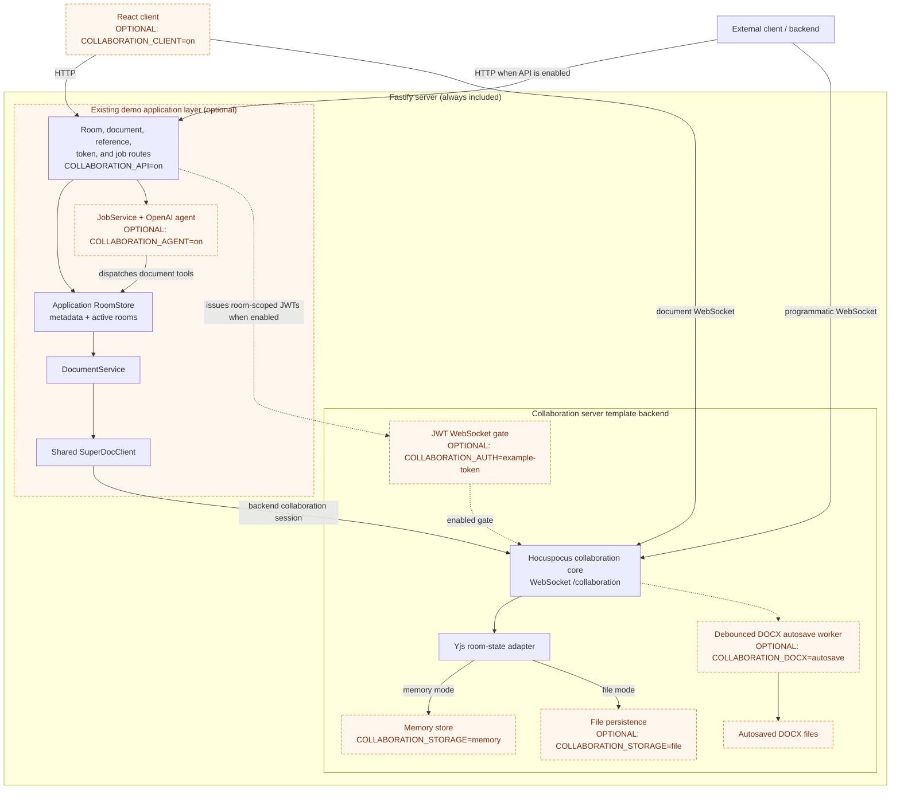

# SuperDoc canonical collaboration demo

A small reference application showing a browser user and a server-side Node agent editing the same SuperDoc document. Everything runs locally, and model requests go directly to OpenAI with your API key.

## Architecture



Orange dashed blocks are optional. The Fastify host and Hocuspocus collaboration core are always present. The bundled React client, HTTP application layer, agent worker, JWT gate, file-backed Yjs persistence, and DOCX autosave can be included or excluded with the flags shown. The room-state adapter is always present, using either memory or file storage; the two storage blocks are alternatives rather than simultaneous destinations.

The browser owns the UI and interactive editor. When enabled, the HTTP application layer owns room metadata, uploads/downloads, references, chat, expiry, token issuance, and jobs. Each application room owns one document object, while `DocumentService` owns the shared SDK client. Browser and backend SDK sessions edit through the same Hocuspocus document. The collaboration layer, adapted from the SuperDoc collaboration server template, owns WebSocket authorization, Yjs room-state storage, and optional debounced DOCX snapshots; it can also run without the bundled client and HTTP application layer.

### Document Upload/Room Creation

When the client creates a blank document or uploads a DOCX, the server performs this sequence:

1. `RoomStore` writes the blank or uploaded DOCX to the ephemeral document directory.
2. `RoomStore` asks `DocumentService` to open the file.
3. `DocumentService` uses its shared `SuperDocClient` to open an SDK document handle.
4. The SDK handle connects to Hocuspocus using the room ID as the document ID and seeds the collaboration state from the DOCX.
5. `DocumentService` creates a `Document` containing the SDK handle, document ID, filename, file path, and generation number.
6. `RoomStore` creates a `Room` that owns the `Document`.
7. The API returns the document metadata and collaboration URL.
8. The browser initializes SuperDoc with that metadata and connects to the same Hocuspocus document.
9. Hocuspocus synchronizes the seeded document state into the browser editor.

After initialization, live document edits travel through Hocuspocus. The source DOCX is not rewritten after every edit. When the document is downloaded, `Document.save()` exports the current SDK state to a temporary DOCX file.

### Prompt Submission/Job Creation

Submitting a prompt creates an asynchronous agent job. The agent applies document edits during its tool-call loop rather than waiting until the job is complete:

1. The client posts the prompt and Reviewing/Editing mode to the API.
2. `JobService` validates the room, creates and queues a server-generated job record, and immediately returns `202 Accepted` with its job ID.
3. When the job reaches the front of the queue, `JobService` calls the shared agent's `run()` method with the room's `Document`.
4. The agent runs its OpenAI tool-call loop.
5. For each document tool call, the agent calls `Document.dispatch()`.
6. The `Document` applies the operation through its SDK handle.
7. The SDK sends the change through Hocuspocus, which synchronizes it to connected browsers.
8. While this work runs, the client polls the job endpoint and observes `queued`, `running`, and eventually a terminal status.
9. When the agent finishes, it returns its textual answer to `JobService` and appends the prompt and answer to the room's conversation.
10. `JobService` marks the job complete, updates the room activity timestamp, and decrements the room's active-job count.

The agent does not communicate with `RoomStore` directly. Document edits go through the room's `Document`; `JobService` manages room access, job status, cancellation, and completion.

## Quick start

Prerequisites:

- Node.js 22 or newer
- `make`
- An OpenAI API key

From this directory:

```bash
cp .env.example .env
```

Add your key to `.env`:

```dotenv
OPENAI_API_KEY=your-key-here
```

The checked-in example profile enables the API, client, and agent while using unauthenticated,
in-memory collaboration with DOCX autosave disabled. These are the same quick-start flags shown
by **Build this app** in the client.

Start the complete stack:

```bash
make dev
```

All service logs are shown by default. Filter them with either launcher form:

```bash
node scripts/dev.mjs --log documentservice
make dev LOG=documentservice
```

`--log` accepts `all`, `api`, `rooms`, `worker`, `agent`, `documentservice`, `collab`, `client`, or `dev`. Use commas for multiple selections, such as `--log api,collab`. The `worker` selection refers to agent-job lifecycle logs; `documentservice` refers to SDK document operations.

The first run installs the Node dependencies. Open [http://localhost:15173](http://localhost:15173). Press Ctrl-C once to stop both processes. The `.env` file is ignored by Git.

## Use the browser application

The client creates a random room ID and adds it to the URL as `?room=...`. Keep or share that URL to reconnect to the same room while the local services remain running.

1. Open a new room to load the bundled `server/assets/contract.docx` sample automatically.
2. Use the four file buttons, left to right: **New Document**, **Replace document**, **Save As**, and **Delete document**. New Document creates a blank document; Replace document imports a `.docx` file.
3. Edit the document directly in SuperDoc.
4. Enter an instruction in the agent panel and select **Run agent**. Enter submits; Shift+Enter adds a new line.
   Select document text first to target a passage. The panel previews its plain text in a scrollable area up to 160px tall and includes it as target context with the prompt. The selection remains available while typing the prompt; choose **Clear** to remove the target and work with the whole document again.
5. While a job is running, select **Stop agent** to cancel remaining work. Edits already applied before cancellation are not rolled back.
6. Use **Save As** to export the collaborative document, or **Delete Document** to remove it.

The agent uses OpenAI streaming. Ordinary text writes always use the streaming tool: alternative paragraph insertion, heading insertion, text replacement, block rewriting and placeholder replacement actions are removed from the agent’s tool schema and rejected by the host if called. No special prompt is needed. Plain-text rewrites and new paragraphs appear progressively in the editor through the existing collaboration connection, and the agent’s chat reply streams into the panel. Streaming handles one paragraph per tool call, including new paragraphs before or after existing passages. Headings and styled prose stream their words first and apply formatting afterward. Structured edits (including tables, lists, citations and footnotes) apply through their dedicated tools after their arguments finish generating. Stopping or losing a stream preserves text already applied. Each chunk uses the host’s Reviewing/Editing mode and verifies its current document target before insertion.

You can type elsewhere while the agent streams. The writer finds its unchanged, unique text within the same paragraph again before each insertion, so typing before it can shift its position. A confirmed `REVISION_MISMATCH` rejection triggers a fresh target/revision read and up to four retries with short backoff; timeouts and uncertain write failures are never automatically replayed. If you change or delete the agent’s target, make it ambiguous, or it can no longer be found in its original paragraph, the job pauses with a notice instead of overwriting your edits. Tracking does not follow text moved into a different paragraph. Sustained revision conflicts also pause after the retry limit. Already-applied text stays in the document; select the intended passage and submit a new prompt to continue. Pausing ends the current model run and does not automatically restart it.

Set `DEFAULT_DOCUMENT_PATH` in the local `.env` file to override the bundled room template. Initialization preserves an existing room and coalesces simultaneous requests for the same new room.

A room contains one document with one stable document ID. Creating or uploading another document calls the Node SDK's `replaceFile()` on the existing backend document session. This atomically resets the shared content without replacing the collaboration identity. Replacement starts a new metadata generation and clears the previous chat history.

The chat panel is isolated in `client/src/components/ChatPanel.tsx`. It communicates only through the public HTTP API and can be replaced with another agent interface.

### Insert citations

Choose **References** to switch from the editor toolbar to the References toolbar; **Home** switches back. Place the cursor in document text, or select a passage, then choose **Insert citation**. Choose a saved reference or enter a new source with its type, title, authors, year, publisher, pages, DOI, and URL. The citation is inserted at the cursor or after the selection, using the document's Editing/Reviewing mode. Sources are stored with the document and included in DOCX exports.

The **Agent** button beside the Home toolbar's tracked-change controls toggles the agent panel while preserving its draft, history, width, and ongoing work. At toolbar widths up to 1800px, insertion and tracked-change buttons stack under their labels, and the native undo/redo and accept/reject controls are hidden. The native toolbar centers its controls and uses its own available width to move excess controls into its overflow menu.

The References toolbar also provides:

- **Insert footnote**: inserts a native numbered footnote at the cursor and moves into its body for typing. The editor owns footnote placement and numbering. When the native API rejects a paragraph containing citation fields, the server inserts the note into a revision-checked DOCX snapshot and reloads it while preserving those fields.
- **Next footnote / Previous footnote**: selects the superscript reference in the main text and centers it in view, following document order and wrapping at either end. Navigation also works in Viewing mode.
- **Citations**: opens the reference library to the right of the agent panel. Double-click a reference to insert it at the document cursor; keyboard users can press Enter on a reference. During insertion, only that reference shows a spinner, the cursor indicates loading, and the document remains visible and scrollable without a blocking overlay. Repeated activation is ignored until the insertion completes.
- **Add reference**: at the top of the Citations panel, opens the source form to save a new reference without requiring a document cursor or inserting a citation. The saved source appears in the panel and becomes available to the agent.
- **Insert bibliography**: inserts a native bibliography at the document end using the current style. Requires the document's Editing mode and shows progress only on the button while keeping scrolling available.
- **Delete an empty bibliography**: in Editing mode, Backspace/Delete clears an empty native bibliography field and its leftover paragraph after the visible text is gone. The server checks that the field and its paragraph are still empty before removing them; saved references and in-text citations remain available. Reviewing mode continues to use the editor's tracked-deletion behavior.
- **Bibliography style**: applies APA 7, Chicago 18 author-date, or MLA 9 to native citation fields and an existing bibliography, using vendored CSL styles and citeproc-js. Source data and field instructions are retained. This control does not create a bibliography where one is absent.

**Highlight citations** and **Highlight footnotes**, immediately left of the render button, independently toggle blue overlays using `ui.viewport.getRect`. Footnote highlights mark the superscript references in the main document. Highlights follow scrolling, zoom, layout changes, and edits in either display mode without changing document formatting or intercepting clicks. Both toggles are local to your browser.

**Render citations & bibliography** and **Option–F9** toggle field codes in the live collaborative document. Editing and Reviewing work in either display mode; Viewing remains read-only. The button is highlighted when results are rendered and shows progress while switching. The display mode is shared within the room. Normal DOCX downloads use rendered results while retaining native field instructions. Switching display or bibliography style preserves pending revisions through a revision-checked DOCX round trip. Wait for an active agent job to finish before switching reference display, formatting, or inserting citations.

Citation sources are saved in the document's Word source catalog. Citation insertion writes a native Word field using its saved source tag in a revision-checked snapshot, applies the current style, and replaces the shared document. This avoids temporary SDK source IDs that stop resolving after V2 reloads. If another edit changes the document while the menu is open, reopen the menu at the intended cursor position before inserting.

Deleting the last visible character of a citation, or selecting its complete text and pressing Backspace/Delete, removes the native citation field through `doc.citations.remove`. If the collaboration runtime returns `unsupported-context`, a server-side revision-checked DOCX fallback removes the exact matching main-document citation. It checks the paragraph, offsets, instruction, and displayed text before writing, preserves surrounding text and the saved source, and records a Word deletion in Reviewing mode. The fallback refuses unsupported nested revision wrappers. Other characters continue through normal editor deletion. Scrolling stays available during the server operation.

DOCX imports load saved Word bibliography source records into **Existing references**. This includes uncited sources, organization authors, and source catalogs stored in different custom XML parts. Imported references can be reused, and exports retain their original Word source tags and full source metadata. Replacing the document replaces its reference library. The menu can also be opened to browse references before placing a cursor in the document.

The chat agent can insert footnotes with `superdoc_insert_footnote({anchor, content, expectedRevision})`. It reads the target paragraph and revision with `superdoc_inspect`, then inserts a native numbered reference and the note text through the toolbar's revision-checked snapshot path. The host applies the request's tracked/direct mode and rejects stale revisions. Imports and exports repair the SDK's document/body wrapper around footnote parts so native notes survive collaboration and DOCX round trips.

The agent also has `superdoc_insert_citation({anchor, sourceId, expectedRevision})`, using the same native Word field insertion and style rendering as the toolbar. It inserts one saved source per call. Each prompt receives the room's current reference library: source IDs, types, full source fields, bibliography style, and 1-based numbers in Citations-panel order. The model can resolve "the first reference" or a source title without guessing IDs. This context is refreshed for each request and is not stored as extra chat messages. Both reference tools enforce the request's tracked/direct mode.

Agent insertion anchors are `{kind: 'afterText', text, sectionHeading?}`, `{kind: 'sectionEnd', sectionHeading}`, or `{kind: 'paragraphEnd', blockId}`. The server resolves exact text and actual heading boundaries in the current DOCX; the model never counts character offsets. Missing or ambiguous anchors fail without an insertion. Successful calls return `resolvedAnchor` with the block, offset, surrounding text, and `verified: true`, after checking the inserted marker/field in the edited snapshot before replacing the shared document. Toolbar insertions continue to use the native cursor selection. The local review-caption adapter corrects SuperDoc 2.18's "Added table" caption for structural footnote insertions to "Added footnote" without changing native IDs or decisions.

Citation and footnote tool schemas enforce each anchor variant with strict decoding. Invalid arguments return exact field paths and corrected examples. Repeating the same failed tool arguments twice stops the run, even if inspections occur between retries. Stopped runs list operations that succeeded and the last failure; the 12-turn limit remains unchanged. The contract, DOCX placement, generic retry policy, and reference-specific reporting are separate modules.

See [reference integration inventory](docs/reference-integration.md) for the native API, custom tool, and workaround boundaries and their removal criteria. Focused synthetic checks run with `node --test server/src/agent.test.js server/src/reference-anchor-contract.test.js server/src/reference-anchors.test.js server/src/reference-tool-progress.test.js tests/footnote-review-labels.test.mjs` (Node 24).

`superdoc_references` manages saved sources with `list`, `get`, `create`, `update`, and `delete` actions. Creation requires a source type and title; other known metadata can include people or organization authors, year, publisher, pages, DOI, and URL. It returns a stable source ID that the agent can immediately use to insert a native citation. Updates patch only supplied fields and refresh citations and an existing bibliography. Deletion refuses still-cited sources. Mutations require the latest inspected/library revision, persist through DOCX export and reimport, and refresh the Citations panel when the agent finishes. Source-library metadata is saved directly; document citation insertion continues to follow Reviewing/Editing mode. Adding a source does not create a bibliography block.

Requests such as "for each paragraph, create citations, but don't insert anything yet" save the distinct source records to the library without inserting citation markers or changing rendered bibliography text. The agent reads the paragraphs, reuses existing sources, creates identifiable missing sources, and reports paragraph coverage. Saving sources is separate from inserting their citations and does not require a second permission request.

`superdoc_bibliographies` manages native bibliography fields with `list`, `get`, `create`, `update`, and `delete`. Creation defaults to the end of the document and its current style, or can go before/after an inspected body paragraph. Update refreshes entries; an optional APA, Chicago, or MLA style applies throughout the document, matching the toolbar. List/get return bibliography IDs and the revision required for mutations. Delete removes the complete field and generated paragraphs while preserving saved sources, in-text citations, and independently typed headings. Mutations currently require Editing mode; Reviewing-mode requests fail without applying direct edits. Reads work in either mode.

Prompts such as "add a bibliography to the last page" select the native bibliography tool first; the agent uses the current style and document-end position without asking for approval. Generic text insertion and style-repair fallbacks are blocked for these creation requests. If the native tool reports a mode restriction, select Editing in the chat panel's **Agent edit mode** dropdown and retry; the document toolbar's mode selector is separate.

Bibliography discovery filters returned Word fields by their actual instruction, since SDK 2.15 does not accept a field-type filter. Existing citations therefore do not count as bibliographies. Failed bibliography calls return the actual tool error directly, without asking for approval or offering plain-text alternatives; only the explicit mode-restriction error suggests changing Agent edit mode.

Bibliography creation writes a native Word field into a revision-checked DOCX snapshot and renders it before replacing the shared document. This avoids SDK paragraph-style resolution and collaboration style-metadata writes during insertion. Generated bibliography entries retain the field paragraph’s style or use the document default; they do not reference an absent Bibliography style. Updates use the same renderer.

Agent tool calls stream live in a separate bubble between the user prompt and the agent response, showing running, completed, or failed status and elapsed tool time. Each saved agent reply retains its own tool-call bubble, newest first. The collapsed bubble shows four complete calls and fades the fifth; clicking expands the full list, and clicking again collapses it. Expanded state is retained when the active job becomes a saved reply. Replies created before tool-call recording was enabled have no recorded trace.

Reviewing-mode typing includes an isolated selection workaround for replacements following earlier tracked deletions in a paragraph. Before native typing begins, it reapplies the selected range in visible coordinates using the public selection API, preventing replacement letters from splitting around deleted text. The implementation lives in `client/src/reference-integration/workarounds/tracked-replacement-caret.ts`, with portable React lifecycle wiring in `client/src/reference-integration/components/TrackedReplacementCaret.tsx`. Native typing retains revision creation and undo. Verify the guards with `node --test tests/tracked-replacement-caret.test.mjs`.

## Customer reference integration

The citation/footnote tools and compatibility fixes are isolated in portable server and browser modules. See [the integration guide](docs/customer-integration.md), [workaround inventory](docs/reference-integration.md), and [agent guidance](AGENTS.md). The customer’s agent can integrate the source with its existing agent loop through `createReferenceAgentAdapter`, retaining native API calls, custom tools, and compatibility fixes together. The demo uses this same adapter.

## Services and ports

`make dev` starts:

| Service | Default address | Responsibility |
| --- | --- | --- |
| React client | `http://localhost:15173` | SuperDoc editor, file controls, and replaceable chat UI |
| Fastify server | `http://localhost:8000` | HTTP API, OpenAI orchestration, agent-job queue, room metadata, and Hocuspocus collaboration |
| Document service | Inside the Fastify process | One shared Node SDK client and all active backend document objects |
| Hocuspocus endpoint | `ws://localhost:8000/collaboration` | Live document synchronization between the browser and backend runtime |

The Fastify process owns the ephemeral room registry, source files, activity timestamps, conversation history, agent-job queue, job records, and one shared `SuperDocClient`. Each room owns a `Document` object containing its metadata and SDK handle. `DocumentService` creates these objects and owns shared SDK startup and shutdown. `RoomStore` may request `Document.close()` during deletion or expiry, but it does not perform SDK operations itself.

Document content travels through Hocuspocus. The browser posts to the room status endpoint every 30 seconds to refresh activity and reconcile lifecycle metadata. Replacement content still arrives immediately through collaboration; metadata changes and deletion are detected by the next status request. Job status is polled separately while a submitted job is active because it is an asynchronous task status API.

## Configuration

| Variable | Default | Purpose |
| --- | --- | --- |
| `COLLABORATION_API` | `on` | Set to `off` to run only the collaboration WebSocket, persistence, auth, and optional DOCX autosave. |
| `COLLABORATION_CLIENT` | `on` | Set to `off` to skip the bundled React client in `make dev` and the root build. |
| `COLLABORATION_AGENT` | `on` | Set to `off` to omit the OpenAI agent worker and its job routes/UI. Requires the API when enabled. |
| `COLLABORATION_AUTH` | `none` | Set to `example-token` to require signed WebSocket credentials. This gates the WebSocket but is not application login: the demo token endpoint trusts its submitted user ID. |
| `COLLABORATION_AUTH_SECRET` | none | JWT signing secret of at least 32 characters; required for `example-token` auth. |
| `COLLABORATION_STORAGE` | `memory` | Use `file` to persist binary Yjs room state across room expiry and process restarts. |
| `COLLABORATION_STORAGE_DIR` | `./data/collaboration-rooms` | Persistent binary Yjs room-state directory. |
| `COLLABORATION_DOCX` | `off` | Set to `autosave` to write DOCX snapshots after the idle debounce. |
| `COLLABORATION_DOCX_DIR` | `./data/collaboration-docx` | Latest autosaved DOCX directory. |
| `COLLABORATION_DOCX_IDLE_MS` | `10000` | Debounce delay before exporting a changed room. |
| `OPENAI_API_KEY` | required with agent enabled | Credential sent directly to OpenAI. |
| `OPENAI_MODEL` | `gpt-5-mini` | Model used by the document agent |
| `ROOM_TTL_SECONDS` | `3600` | Room expiry period since its last recorded activity |
| `COMPLETED_JOB_TTL_SECONDS` | `600` | Retention period for terminal job records |
| `CLIENT_ORIGINS` | Local client URLs and `https://demos.superdoc.dev` | Comma-separated browser origins allowed by CORS |

Local service URLs and ports are configured in `scripts/dev.mjs`.

The component flags follow the quick-start server's mode convention: named values such as `on`, `off`,
`example-token`, `none`, and `autosave` are validated at startup instead of treating arbitrary strings as booleans.
The server is interpreted JavaScript rather than a bundled artifact: API and agent flags prevent those modules from
being imported or initialized at runtime, while the root build validates the server and conditionally bundles the client.

Common compositions:

```bash
# Full client + API + agent stack (the default)
make dev

# Client and API without the OpenAI agent worker
COLLABORATION_AGENT=off make dev

# Collaboration quick-start backend only
COLLABORATION_API=off COLLABORATION_CLIENT=off COLLABORATION_AGENT=off make dev

# Opt into the secured, file-persisted backend modes
export COLLABORATION_AUTH=example-token
export COLLABORATION_AUTH_SECRET="$(openssl rand -hex 32)"
export COLLABORATION_STORAGE=file
export COLLABORATION_DOCX=autosave
make dev

# Validate the server without producing a client bundle; runtime also omits the API agent
COLLABORATION_CLIENT=off COLLABORATION_AGENT=off npm run build
```

## Deployment

The shared demos release workflow builds the client with a relative asset base and publishes it to [https://demos.superdoc.dev/collab/](https://demos.superdoc.dev/collab/). The production build reads the backend origin from the GitHub Actions variable `COLLAB_API_URL`, falling back to the canonical Railway domain.

The same production workflow deploys `server/` to Railway and then verifies `/api/health` before publishing the frontend. It requires these GitHub Actions secrets:

- `RAILWAY_TOKEN`: a project-scoped Railway token for the production environment
- `RAILWAY_SERVICE_ID`: the target Railway service ID

The Railway service owns runtime configuration, including `OPENAI_API_KEY`, `COLLABORATION_AUTH_SECRET`, and `PUBLIC_ORIGIN`. Set `PUBLIC_ORIGIN` to the service's HTTPS Railway domain without a trailing slash. Put `COLLABORATION_STORAGE_DIR` and `COLLABORATION_DOCX_DIR` on durable storage before treating restart persistence as production-ready.

## HTTP API

Room IDs must contain 1–100 letters, numbers, underscores, or hyphens.

| Method | Path | Behavior |
| --- | --- | --- |
| `GET` | `/api/health` | Check server health |
| `GET` | `/api/rooms/{roomId}` | Read room state; returns `document: null` when empty |
| `POST` | `/api/rooms/{roomId}/initialize` | Open the existing room, or initialize it from the default contract without replacing existing content |
| `POST` | `/api/rooms/{roomId}/document` | Create or replace with a blank document |
| `PUT` | `/api/rooms/{roomId}/document` | Upload or replace with a `.docx` file |
| `GET` | `/api/rooms/{roomId}/document` | Export and download the current collaborative DOCX |
| `GET` | `/api/rooms/{roomId}/document/info` | Read document and collaboration metadata |
| `PATCH` | `/api/rooms/{roomId}/document` | Dispatch one SuperDoc toolkit operation through the backend SDK |
| `GET` | `/api/rooms/{roomId}/citation-sources` | Read saved citation sources and the server document revision |
| `POST` | `/api/rooms/{roomId}/citation-sources` | Add a source using `{generation, input}` with SDK source fields and `expectedRevision` |
| `POST` | `/api/rooms/{roomId}/citations` | Insert a citation using `{generation, input}` with SDK target, source ID, change mode, and `expectedRevision` |
| `DELETE` | `/api/rooms/{roomId}/citations` | Remove an exact native citation from a DOCX snapshot using `{generation, input: {target, instruction, displayText, changeMode, expectedRevision}}` |
| `POST` | `/api/rooms/{roomId}/bibliography-style` | Format native citation and bibliography fields using `{generation, style, expectedRevision}` |
| `POST` | `/api/rooms/{roomId}/bibliographies` | Insert a native bibliography at the document end using `{generation, expectedRevision}` and the current style |
| `DELETE` | `/api/rooms/{roomId}/bibliographies/{bibliographyId}/empty` | Remove an empty bibliography and its paragraph using `{generation, expectedRevision}`; refuse to remove visible content |
| `POST` | `/api/rooms/{roomId}/reference-display` | Switch editable shared field-code/results display using `{generation, fieldCodes, expectedRevision}` |
| `POST` | `/api/rooms/{roomId}/footnotes` | Insert a footnote beside existing fields using `{generation, input: {at, changeMode, expectedRevision}}` |
| `DELETE` | `/api/rooms/{roomId}/document` | Delete the document and room state |
| `POST` | `/api/rooms/{roomId}/status` | Refresh activity and return current metadata with a stale-generation indicator |
| `GET` | `/api/rooms/{roomId}/chat` | Read completed agent conversation messages |
| `POST` | `/api/rooms/{roomId}/collaboration-token` | Issue a five-minute JWT scoped to this room using `{userId}`; this demo endpoint trusts the caller-supplied identity |
| `POST` | `/api/rooms/{roomId}/jobs` | Enqueue an agent prompt |
| `GET` | `/api/rooms/{roomId}/jobs/{jobId}` | Read job status and result |
| `GET` | `/api/rooms/{roomId}/jobs/{jobId}/events` | Stream job status and tool-call updates as server-sent events |
| `DELETE` | `/api/rooms/{roomId}/jobs/{jobId}` | Cancel a queued or running job |

### End-to-end API example

Create a blank document:

```bash
curl -X POST http://localhost:8000/api/rooms/demo-room/document
```

Add an agent job:

```bash
curl -i -X POST http://localhost:8000/api/rooms/demo-room/jobs \
  -H 'Content-Type: application/json' \
  -d '{"prompt":"Add a heading named Project Overview followed by a short introductory paragraph.","isSuggesting":true}'
```

The response is `202 Accepted`. Copy the generated `id` from the response body or use the URL in the `Location` header.

Read the job status:

```bash
curl http://localhost:8000/api/rooms/demo-room/jobs/job_RETURNED_ID
```

Repeat until `status` is `completed`, `failed`, or `cancelled`. Then download the modified document:

```bash
curl -o modified-document.docx \
  http://localhost:8000/api/rooms/demo-room/document
```

### Replace the document without changing its ID

```bash
curl -X PUT http://localhost:8000/api/rooms/demo-room/document \
  -F 'file=@./example.docx'
```

Uploads must be non-empty `.docx` files no larger than 25 MB. If the room already exists, the response increments `generation` while retaining the same `document_id`. Replacement is rejected while an agent job is active.

### Dispatch a SuperDoc operation directly

`PATCH /document` bypasses the model and dispatches a SuperDoc toolkit operation on the same backend document handle:

```bash
curl -X PATCH http://localhost:8000/api/rooms/demo-room/document \
  -H 'Content-Type: application/json' \
  -d '{"tool":"superdoc_perform_action","arguments":{"action":"insert_heading","text":"Executive Summary","level":1,"placement":{"at":"document_start"}}}'
```

Set `isSuggesting` to `true` for tracked agent changes or `false` for direct edits. Prompts use the completed conversation history for the current document. Job IDs are generated by the server and cannot be supplied by clients.

## Verify collaboration

1. Create or upload a document in the browser.
2. Make a manual edit.
3. Ask the agent to make a distinct edit and confirm it appears in the editor.
4. Replace the document through `curl` and confirm the open editor resets without changing the document ID or reloading the page.
5. Choose **Save As** and confirm the exported DOCX includes subsequent browser and agent edits.
6. Close the browser, enqueue another job through the API, then reopen the same room URL and confirm the backend edit is present.

Structured diagnostics appear in the `make dev` terminal with `[api]`, `[rooms]`, `[worker]`, `[agent]`, `[document-service]`, `[collab]`, and `[dev]` prefixes.

## Ephemeral state and expiry

- A room holds one document and one conversation.
- Replacement retains the document ID, increments its generation, and clears its conversation.
- Terminal job records expire after 10 minutes by default.
- Rooms unload from the API after one hour without recorded activity from a status heartbeat, a room/document/chat request that resolves the room, a collaboration change, or agent execution by default. Job-status polling alone does not refresh room activity.
- The browser checks room status every 30 seconds, including while the room is empty; an existing room records that check as activity.
- Cleanup runs once per minute, so unloading can occur up to roughly one minute after the deadline. Explicit document deletion removes persisted Yjs state and any autosaved DOCX; idle expiry retains both.
- Active jobs prevent room expiry.
- Binary Yjs room state is stored under `COLLABORATION_STORAGE_DIR`, and debounced DOCX snapshots are stored under `COLLABORATION_DOCX_DIR`. Reinitializing the same room ID rejoins persisted Yjs state after expiry or restart. API metadata such as the original filename, chat, and jobs remains in memory and is reconstructed or reset rather than durably restored.
- DOCX autosave runs after the configured idle debounce. The collaboration template can also save when its final connection leaves; in this API-integrated demo, `DocumentService` keeps a backend SDK session connected for each active room, so closing the browser alone does not normally trigger that path.

## Code map

- Fastify and Hocuspocus setup, health and collaboration routes, hooks, cleanup, and shutdown: `server/src/server.js`
- Authentication, Yjs storage, and DOCX autosave adapted from the SuperDoc collaboration server template: `server/src/collaboration/`
- Room, document, chat, status, and job routes: `server/src/rooms/routes.js`
- Room metadata, source files, replacement coordination, export, and expiry: `server/src/rooms/store.js`
- Demo SDK startup and document registration: `server/src/document-service.js`
- Portable document operations, tools, agent policy, and workarounds: `server/src/reference-integration/`
- Demo OpenAI/model/logging injection: `server/src/agent.js`
- Portable browser adapters and injected demo transport: `client/src/reference-integration/`, `client/src/reference-transport.ts`
- In-memory queue, cancellation, and job state: `server/src/job-service.js`
- Browser API and room-status client: `client/src/api.ts`
- Replaceable agent UI: `client/src/components/ChatPanel.tsx`
- SuperDoc editor: `client/src/components/DocumentEditor.tsx`
- One-command launcher: `scripts/dev.mjs`

## Production boundary

This demo packages a runnable local collaboration topology; it is not a production deployment template. Its default example profile disables WebSocket authentication and persistence for a zero-configuration quick start. The optional token endpoint is still demo infrastructure rather than application login: it trusts the submitted demo user ID, so a production owner must authenticate its HTTP API caller and authorize room access before issuing a token. File-backed Yjs state alone does not restore API room metadata or reopen SDK documents after restart. Production also needs durable room metadata and job storage, queue recovery, multi-process collaboration coordination, rate limits, observability, backups, TLS, and deployment-specific CORS and public URLs.

Integrators can replace the chat component and agent orchestration while retaining the HTTP document surface and SuperDoc collaboration connection. They would operate this Node service or an equivalent implementation preserving the synchronization and state contracts.
