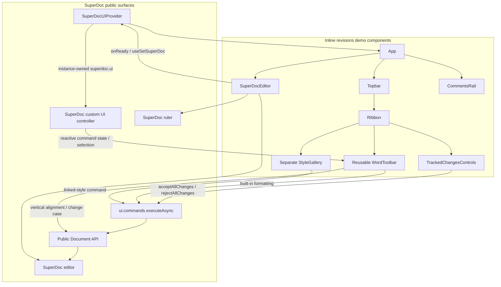

The toolbar uses `superdoc/ui/react` hooks under the shared provider. The
provider binds to the mounted editor's own `superdoc.ui` controller; it does not
create a second editor or document. The vendor toolbar is disabled with
`ui.toolbar: false` because `WordToolbar` supplies the visible controls.

Built-in formatting commands use `ui.commands.executeAsync`, which routes
through SuperDoc's public command controller to document operations. The style
gallery uses the same controller's `linked-style` command. Both read live editor
state rather than maintaining a separate formatting model.

For operations without a built-in UI command, the toolbar uses the bound host's
public `activeEditor.doc` facade:

- Subscript/superscript: `format.apply` with `inline.vertAlign`.
- Change case: `invoke` with the `replace` operation.

These operations use a captured SuperDoc selection as their target, request
tracked changes in Reviewing mode, and guard mutations in Viewing mode. The
implementation does not use legacy editor commands or DOM-based formatting.
Pink placeholder controls intentionally perform no document mutation.

The separate `TrackedChangesControls` component uses `useSuperDocCommand` for
`acceptAllChanges` and `rejectAllChanges`. Buttons reflect the controller's live
enabled state and stay disabled while a bulk decision is pending.
